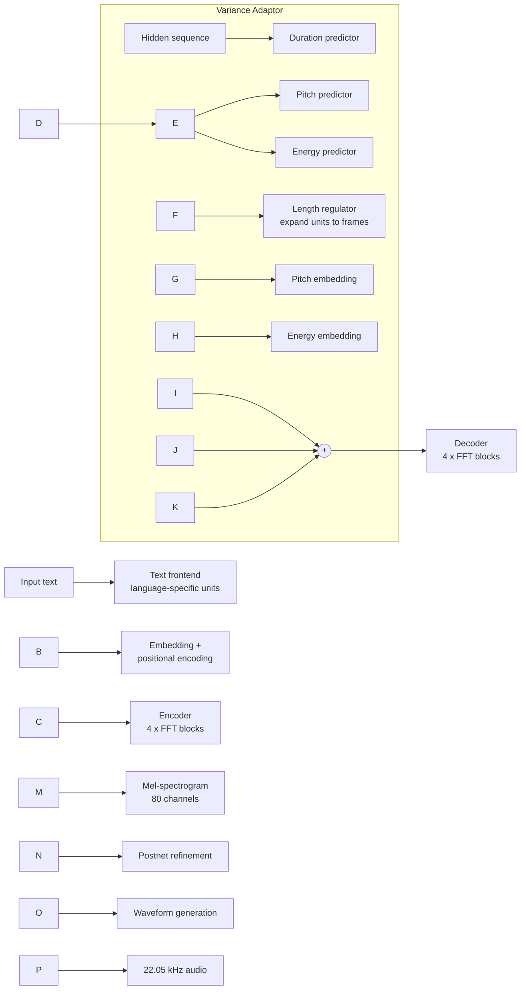
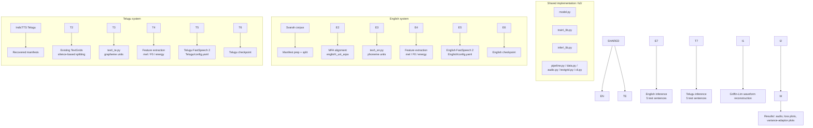

<div align="center">

# Bilingual FastSpeech 2 Text-to-Speech

### Separate English and Telugu Acoustic Models in a Shared PyTorch Codebase

*Assignment submission — Language Technologies Research Centre (LTRC), IIIT Hyderabad*

!\[Python](https://img.shields.io/badge/Python-3.x-blue)
!\[PyTorch](https://img.shields.io/badge/PyTorch-%E2%89%A52.0-ee4c2c)
!\[Model](https://img.shields.io/badge/Model-FastSpeech%202-6f42c1)
!\[Languages](https://img.shields.io/badge/Languages-English%20%7C%20Telugu-success)
!\[Vocoder](https://img.shields.io/badge/Inference%20vocoder-Griffin--Lim-orange)

**Author:** Syeda Alia Samia  |  **Submission date:** 07 November 2026

</div>

\---


\## Trained Model Checkpoints


The trained FastSpeech 2 model checkpoints for both English and Telugu are available here:


\*\*\[Download Model Checkpoints – Google Drive](https://drive.google.com/drive/folders/1kAvvI4z1c\_CsRc8cKz7DP6T33b1nWC9W?usp=sharing)\*\*


The folder contains the trained model files for the bilingual TTS implementation.


\---


## Table of Contents

1. [Project Overview](#1-project-overview)
2. [Objectives and Key Contributions](#2-objectives-and-key-contributions)
3. [FastSpeech 2 Architecture](#3-fastspeech-2-architecture)
4. [Bilingual System Architecture](#4-bilingual-system-architecture)
5. [Datasets](#5-datasets)
6. [Preprocessing](#6-preprocessing)
7. [Model and Training Configuration](#7-model-and-training-configuration)
8. [Training and Validation Results](#8-training-and-validation-results)
9. [Generated Speech Samples](#9-generated-speech-samples)
10. [Variance-Adaptor Visualisations](#10-variance-adaptor-visualisations)
11. [Repository Structure](#11-repository-structure)
12. [Installation](#12-installation)
13. [Preprocessing, Training and Inference](#13-preprocessing-training-and-inference)
14. [Checkpoint Access](#14-checkpoint-access)
15. [Limitations](#15-limitations)
16. [Future Improvements](#16-future-improvements)
17. [References](#17-references)

\---

## 1\. Project Overview

This repository contains two **separately trained** FastSpeech 2 text-to-speech systems, one for **English** and one for **Telugu**. Both are built on a shared PyTorch implementation (`fs2/`) that was adapted from a reference FastSpeech 2 implementation. Each language has its own configuration, text-processing module, dataset manifests and command-line entry points.

||English|Telugu|
|-|-|-|
|Corpus|AI4Bharat **Svarah**|**IndicTTS Telugu**|
|Input units|Phonemes (ARPAbet-style, via `g2p\_en` and a pronunciation dictionary)|Unicode grapheme / code-point units (grapheme-to-grapheme dictionary)|
|Alignment|Montreal Forced Aligner, `english\_us\_arpa` acoustic model|Existing Telugu TextGrids (alignment stage not re-run)|
|Training steps|30,000|30,000|
|Best validation loss|3.6364 (step 13,000)|2.1832 (step 11,000)|

> \*\*Evidence note.\*\* All numbers and artifacts in this README come from the project's recorded logs, configuration and technical report. No perceptual quality claim (MOS, ABX, intelligibility, pronunciation accuracy) is made, because no listening study was conducted. See \[Limitations](#15-limitations).

\---

## 2\. Objectives and Key Contributions

**Assignment objectives**

* Understand and adapt a reference FastSpeech 2 implementation.
* Train **two separate models** (English and Telugu) on the specified corpora, with non-overlapping training and validation data.
* Generate speech for all required test sentences (five per language).
* Analyse the duration, pitch (F0) and energy predictions of the variance adaptor.
* Document preprocessing, configuration, results and reproducibility.

**Contributions**

* A **single shared implementation** (`fs2/`) with language-specific entry points, so training and inference logic is maintained once.
* **English path:** Svarah manifest preparation, MFA forced alignment, phoneme-based text processing with a stress-related dictionary correction.
* **Telugu path:** Telugu text module operating on grapheme/code-point units, a grapheme-to-grapheme dictionary, reuse of existing TextGrid alignments, punctuation mapped to a pause token, and splitting of long utterances at aligned silences so segments do not exceed 15 s.
* **Separate YAML configurations** per language with a common acoustic-feature setup.
* Recorded **loss logs and plots**, **10 generated WAV files**, inference summaries, and **30 variance-adaptor plots** (duration, pitch, energy × 10 sentences).

\---

## 3\. FastSpeech 2 Architecture

FastSpeech 2 is a non-autoregressive acoustic model. A variance adaptor predicts duration, pitch and energy; the duration predictor drives a length regulator that expands the encoder output to the mel-frame rate, enabling parallel decoding.



\---

## 4\. Bilingual System Architecture

The two languages share code and acoustic feature settings but **not** models, text inventories, dictionaries or manifests.



\---

## 5\. Datasets

### English: AI4Bharat Svarah

|Item|Value|
|-|-|
|Target training / validation audio|5.0 h / 1.0 h|
|Duration filter|1.5 s – 15.0 s|
|Random seed|1234|
|Downloaded WAV files (16 kHz)|4,377 (0 missing, no duplicate IDs)|
|Split (recordings)|3,140 train / 610 validation, **no recording-ID overlap**|
|Feature segments|3,138 train / 610 validation (2 training segments dropped as `spn`)|
|Aligned TextGrids (MFA)|3,750|
|Vocabulary size|71|

### Telugu: IndicTTS Telugu

|Item|Value|
|-|-|
|Source|Recovered Telugu manifests (distinct training and validation manifests)|
|Alignments|Existing Telugu TextGrids (alignment not re-run)|
|Text units|Telugu grapheme / code-point units|
|Maximum segment length|15 s (long utterances split at sufficiently long aligned silences)|

> The archived Telugu materials do \*\*not\*\* include a complete numeric audit (hours, utterance counts, source-recording overlap, speaker distribution) comparable to the English audit. This README therefore does not state Telugu hour or utterance counts, and the English "no overlap" audit is \*\*not\*\* extended to Telugu.

\---

## 6\. Preprocessing

### Shared acoustic features (both languages)

|Parameter|Value|
|-|-|
|Sample rate|22,050 Hz|
|FFT size / window size / hop size|1,024 / 1,024 / 256|
|Mel channels|80|
|Mel frequency range|0 – 8,000 Hz|
|F0|Extracted with PyWorld|
|Energy|Derived from STFT magnitude norm|
|Normalisation|Training-set statistics|

### English text handling

Phoneme-oriented processing with a pronunciation dictionary and a stress-related dictionary correction, aligned with MFA (`english\_us\_arpa`).

### Telugu text handling

Unicode grapheme/code-point units with a grapheme-to-grapheme dictionary. Whitespace and punctuation are not treated as ordinary input tokens; punctuation symbols map to a pause token. Existing TextGrids are audited for coverage during preparation.

Separate text modules keep the two scripts' representations independent while the acoustic model and training pipeline stay common.

\---

## 7\. Model and Training Configuration

Both `English/config.yaml` and `Telugu/config.yaml` specify:

|Component|Setting|
|-|-|
|Model dimension|256|
|Encoder / decoder layers|4 / 4|
|Attention heads|2|
|Feed-forward dimension / kernel size|1,024 / 9|
|Dropout|0.2|
|Variance-adaptor filter dim / kernel size|256 / 3|
|Quantisation bins (pitch, energy)|256|
|Training steps|30,000|
|Warm-up steps|4,000|
|Learning rate|0.001|
|Gradient clipping|1.0|
|Logging / validation / checkpoint interval|every 100 / 1,000 / 2,000 steps|
|Batch frame budget / max batch size|14,000 / 32|
|Seed|1234|

> These are configuration values. No independent re-run was performed when preparing this documentation.

\---

## 8\. Training and Validation Results

### Summary (from recorded loss logs)

|Language|Log rows|Train loss (first)|Train loss (last)|Best validation loss|Best-val step|
|-|-:|-:|-:|-:|-:|
|English|350 (319 train / 31 val)|13.2138|1.0701|3.6364|13,000|
|Telugu|357 (325 train / 32 val)|13.9902|0.8980|2.1832|11,000|

|Language|First validation|Final validation|Minimum validation|
|-|-:|-:|-:|
|English|4.1928|3.7010|3.6364 (step 13,000)|
|Telugu|2.6989|2.1979|2.1832 (step 11,000)|

**Reading the curves.** Training loss decreases steadily in both languages. Validation loss drops quickly early on and then fluctuates in a narrow band, and the final validation value does not equal the best one. The decreasing training curve alone is not treated as evidence of absence of overfitting, and loss alone does not establish perceptual intelligibility or naturalness. Raw loss values are not a valid cross-language ranking of speech quality, because unit inventories, feature distributions and data pipelines differ.

### English

|Training loss|Validation loss|
|:-:|:-:|
|!\[English training loss](Results/English/training\_loss.png)|!\[English validation loss](Results/English/validation\_loss.png)|

### Telugu

|Training loss|Validation loss|
|:-:|:-:|
|!\[Telugu training loss](Results/Telugu/training\_loss.png)|!\[Telugu validation loss](Results/Telugu/validation\_loss.png)|

\---

## 9\. Generated Speech Samples

All ten files are WAV at 22,050 Hz, generated with **Griffin–Lim** reconstruction (see [Limitations](#15-limitations)). GitHub does not embed audio players in README files; click a link to open or download the file.

### English

|ID|Test sentence|Audio|Duration (s)|
|-|-|-|-:|
|E1|The antidisestablishmentarianism movement gained considerable momentum during the parliamentary proceedings.|[E1.wav](Results/English/test_generated_audios/E1.wav)|6.769|
|E2a|The orchestra's conduct during the ceremony was praised by the audience.|[E2a.wav](Results/English/test_generated_audios/E2a.wav)|4.272|
|E2b|The researchers will conduct an experiment to evaluate the proposed method.|[E2b.wav](Results/English/test_generated_audios/E2b.wav)|4.319|
|E3|The rhyth m of the orchestra changed unexpectedly.|[E3.wav](Results/English/test_generated_audios/E3.wav)|3.576|
|E4|The meeting will start at 10:45 AM on 12 November 2026, so andaroo should arrive on time.|[E4.wav](Results/English/test_generated_audios/E4.wav)|7.686|

> E3 is reproduced exactly as printed in the assignment PDF, including the internal space in "rhyth m". It appears to be a typographical anomaly in the source and was deliberately not corrected.

### Telugu

The exact Telugu test strings are stored in the Telugu test-sentence JSON file under `Telugu/` and are taken verbatim from the assignment. T4 contains a date/time expression ("2026", "12", "10:45").

|ID|Audio|Duration (s)|
|-|-|-:|
|T1|[T1.wav](Results/Telugu/test_generated_audios/T1.wav)|4.899|
|T2a|[T2a.wav](Results/Telugu/test_generated_audios/T2a.wav)|2.403|
|T2b|[T2b.wav](Results/Telugu/test_generated_audios/T2b.wav)|2.705|
|T3|[T3.wav](Results/Telugu/test_generated_audios/T3.wav)|2.310|
|T4|[T4.wav](Results/Telugu/test_generated_audios/T4.wav)|8.104|

Durations were measured from the WAV headers. They verify that the files were generated; they do **not** establish pronunciation correctness or listener-rated quality, and no MOS, ABX or word-error score exists for these samples.

\---

## 10\. Variance-Adaptor Visualisations

For every test sentence, the variance adaptor's predicted **duration (ms per unit)**, **pitch (F0, Hz)** and **energy** are plotted. English plots are labelled with phoneme tokens; Telugu plots use token indices that map to the sequence in each sentence's inference summary. These are model outputs, not calibrated measurements, and pitch/energy values depend on the extraction and normalisation procedure.

### English

|Sentence|Duration|Pitch (F0)|Energy|
|-|:-:|:-:|:-:|
|E1||||
|E2a||||
|E2b||||
|E3||||
|E4||||

### Telugu

|Sentence|Duration|Pitch (F0)|Energy|
|-|:-:|:-:|:-:|
|T1||||
|T2a||||
|T2b||||
|T3||||
|T4||||

### Observations visible in the plots

* **Duration:** in every English and Telugu plot, the final token (a trailing pause/`sp` unit) receives by far the longest predicted duration, e.g. roughly 400 ms in E1, and about 500–650 ms across the Telugu sentences. Longer sentences (E1, E4, T1, T4) have correspondingly more units. E4 and T4 also show an additional isolated long-duration token inside the sentence. Whether any of these allocations is a fault would require alignment and audio evidence, so they are not labelled errors here.
* **Pitch:** predictions vary across the unit sequence rather than staying flat, and tend to drift downward toward the end of each sentence in the plots shown. This indicates a changing contour but does not prove natural intonation.
* **Energy:** predicted energy varies from unit to unit, with the final pause token near zero in the plots.

A full per-sentence written analysis is provided in the technical report.

\---

## 11\. Repository Structure

```text
project/
├── English/
│   ├── train.py
│   ├── preprocess.py
│   ├── inference.py
│   ├── config.yaml
│   └── checkpoints/
├── Telugu/
│   ├── train.py
│   ├── preprocess.py
│   ├── inference.py
│   ├── config.yaml
│   └── checkpoints/
├── fs2/                      # shared implementation
│   ├── model.py              # model components
│   ├── train\_lib.py          # training
│   ├── infer\_lib.py          # inference
│   ├── pipeline.py           # data preparation / feature-extraction stages
│   ├── data.py               # dataset access
│   ├── audio.py              # audio and feature utilities
│   ├── text\_en.py            # English text processing
│   ├── text\_te.py            # Telugu text processing
│   ├── textgrid.py           # alignment data handling
│   └── cli.py                # command-line entry points
├── Results/
│   ├── English/
│   │   ├── training\_loss.png
│   │   ├── validation\_loss.png
│   │   ├── test\_generated\_audios/
│   │   └── variance\_adaptor\_plots/
│   │       ├── duration/
│   │       ├── pitch/
│   │       └── energy/
│   └── Telugu/
│       ├── training\_loss.png
│       ├── validation\_loss.png
│       ├── test\_generated\_audios/
│       └── variance\_adaptor\_plots/
│           ├── duration/
│           ├── pitch/
│           └── energy/
├── Report/
│   └── Technical\_Report.pdf
├── README.md
└── requirements.txt
```

The language-level `train.py`, `preprocess.py` and `inference.py` are intentionally compact entry points that delegate to `fs2/`; language-specific configuration, dictionaries, manifests and test sentences stay in their own folders.

\---

## 12\. Installation

**Python dependencies** (see `requirements.txt`): PyTorch ≥ 2.0, NumPy, SciPy, librosa ≥ 0.10, SoundFile, PyWorld, Matplotlib, PyYAML, num2words, g2p\_en, NLTK, tqdm, ReportLab.

```bash
pip install -r requirements.txt
```

**Montreal Forced Aligner** (needed for the English alignment stage) is installed separately in a Conda environment, not through `requirements.txt`. Follow the official MFA installation instructions.

**Configure paths first.** The YAML files contain absolute Google Drive paths from the original Colab environment. Update the paths in `English/config.yaml` and `Telugu/config.yaml` to match your own workspace before running anything.

\---

## 13\. Preprocessing, Training and Inference

These commands are the repository workflow templates. Paths and data availability must be configured first.

### English

```bash
python English/preprocess.py --stage prepare    # Svarah manifest preparation and split
python English/preprocess.py --stage align      # MFA forced alignment
python English/preprocess.py --stage features   # mel / F0 / energy extraction
python English/train.py
python English/inference.py
```

### Telugu

```bash
python Telugu/preprocess.py --stage prepare     # reads recovered manifests and existing TextGrids
python Telugu/preprocess.py --stage features
python Telugu/train.py
python Telugu/inference.py
```

The Telugu workflow reuses existing alignments, so it has no separate alignment stage.

\---

## 14\. Checkpoint Access

Separate English and Telugu checkpoints are required by the assignment and belong in `English/checkpoints/` and `Telugu/checkpoints/`.

> \*\*Status:\*\* the project archive used to prepare this documentation did not contain the trained `.pt` checkpoint binaries; they are stored in the original working Drive project. They exceed GitHub's ordinary file-size limit, so they must be published through \*\*Git LFS\*\* or a \*\*persistent external download link\*\*.
>
> \*\*TODO before submission (replace this block):\*\*
>
> | Model | Location |
> |---|---|
> | English | `<add Git LFS path or download link here>` |
> | Telugu | `<add Git LFS path or download link here>` |
>
> Add download/placement instructions here and confirm the links stay accessible during evaluation.

\---

## 15\. Limitations

* **Griffin–Lim instead of a neural vocoder.** The HiFi-GAN generator checkpoint named in the configuration was not available at inference time, so all ten samples use Griffin–Lim. This is not equivalent to neural-vocoder synthesis and may limit naturalness and detail. The acoustic model and waveform reconstruction should be evaluated separately.
* **No formal listening evaluation.** No MOS, ABX, word-error, intelligibility test or pronunciation annotation exists. Observations here are about model outputs and logs, not perceived speech quality.
* **Incomplete Telugu data audit.** No complete numeric Telugu duration/split audit, and no proof of source-recording disjointness, is present in the archive.
* **Single-speaker setup.** The English workflow records a single speaker label, so speaker-independent generalisation is not claimed.
* **Loss values are not comparable across languages.** The lower Telugu validation loss does not imply better Telugu synthesis.
* **Challenging test items.** The test set includes a very long English word, "conduct" used in two senses, a source-text spacing anomaly (E3), a mixed-language name ("andaroo"), Telugu grapheme sequences, and date/time expressions. Pronunciation on these items has not been formally assessed.
* **Environment-specific paths.** Configurations contain Colab/Drive absolute paths that must be edited.

\---

## 16\. Future Improvements

* Obtain and validate the compatible **HiFi-GAN generator checkpoint** and regenerate all samples.
* Run a **native-speaker listening study** with targeted pronunciation checks and objective TTS measures under clear protocols.
* Produce a **machine-readable Telugu data audit** (source recordings, selected durations, segment counts, split overlap, speaker distribution).
* Broaden **speaker coverage** and evaluate **out-of-domain text**.
* Refine **language-specific normalisation** (numbers, dates, mixed-language names) and pronunciation handling.
* Compare **vocoder options**.
* Record exact **package versions** from the execution environment for a full reproducibility package.

\---

## 17\. References

1. Y. Ren et al., "FastSpeech 2: Fast and High-Quality End-to-End Text to Speech" (arXiv:2006.04558). Architecture reference for this project.
2. IIIT Hyderabad, Language Technologies Research Centre. *Implementation of FastSpeech 2-Based Text-to-Speech Synthesis* — assignment brief, deadline 07-11-2026.
3. AI4Bharat. **Svarah** speech corpus (English training and validation data).
4. **IndicTTS Telugu** speech corpus and alignment resources (Telugu training and validation data).
5. Montreal Forced Aligner and PyWorld documentation (English alignment and F0 extraction).

> Dataset and tool citations should be completed with official publication/repository references before the repository is made public.

For the full implementation approach, per-language modifications, convergence analysis and discussion, see [`Report/Technical\_Report.pdf`](Report/Technical_Report.pdf).

